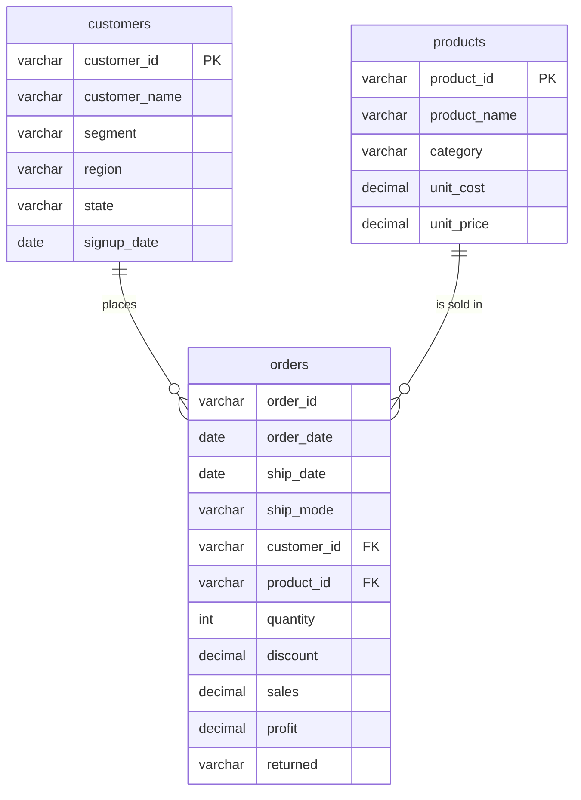

# Retail Sales Analysis with SQL Server

A beginner-to-intermediate SQL project that analyzes retail sales data and answers **8 business questions** using T-SQL.

---

## Project Overview

A retail company wants to understand how its business performs: how much it sells, which products and customers matter most, which regions perform best, and where it loses money through returns.

This project loads three related tables into **SQL Server**, joins them with a single view, and answers 8 business questions with simple, readable queries.

## Tools Used

| Tool | Purpose |
|------|---------|
| SQL Server (Express) | Database engine |
| SSMS | Writing and running queries |
| Power BI (optional) | Dashboard for the key results |
| GitHub | Sharing the project |

## Dataset

The data covers orders placed from **January 2022 to December 2023** (1,500 orders, 2,841 order lines) and is split into three tables.

| Table | Description | Key columns |
|-------|-------------|-------------|
| `customers` | 220 customers | `customer_id`, `segment`, `region`, `state`, `signup_date` |
| `products` | 25 products in 5 categories | `product_id`, `product_name`, `category`, `unit_cost`, `unit_price` |
| `orders` | One row per product in an order | `order_id`, `order_date`, `ship_mode`, `customer_id`, `product_id`, `quantity`, `discount`, `sales`, `profit`, `returned` |

**Categories:** Electronics, Furniture, Office Supplies, Clothing, Home & Kitchen
**Customer segments:** Consumer, Corporate, Home Office
**Regions:** North, South, East, West, Central
**Ship modes:** Standard, Express, Same Day

### Table Relationships



---

## Repository Structure

```
.
├── README.md
├── queries.sql        # View + the 8 business queries
├── customers.csv
├── products.csv
├── orders.csv

```

## How to Run

1. Import the three CSV files into SQL Server as tables named `customers`, `products`, and `orders`
   (SSMS: right-click the database → Tasks → Import Flat File).
2. Check the column types: dates as `date`, `quantity` as `int`, money columns as `decimal`, and `returned` as text (`Yes` / `No`).
3. Open `queries.sql` and run the `CREATE OR ALTER VIEW v_sales` part once.
4. Run each question one at a time (select the query, then press Execute).

---

## The View Used in All Queries

To keep the queries short, one view joins the three tables:

```sql
CREATE OR ALTER VIEW v_sales AS
SELECT
    o.order_id, o.order_date, YEAR(o.order_date) AS order_year,
    o.ship_mode, o.quantity, o.discount, o.sales, o.profit, o.returned,
    c.customer_id, c.customer_name, c.segment, c.region,
    p.product_name, p.category
FROM orders AS o
JOIN customers AS c ON c.customer_id = o.customer_id
JOIN products  AS p ON p.product_id  = o.product_id;
```

---

## Business Questions

| # | Question | SQL Skills Used |
|---|----------|-----------------|
| 1 | What are the overall business numbers? | `COUNT DISTINCT`, `SUM`, `CAST` |
| 2 | How do sales and profit change from year to year? | `GROUP BY`, `ORDER BY` |
| 3 | Which product category brings the most sales and profit? | `GROUP BY`, `SUM` |
| 4 | What are the top 5 most profitable products? | `TOP`, `GROUP BY` |
| 5 | Who are the top 10 customers by sales? | `TOP`, `GROUP BY` |
| 6 | Which region sells the most, and which segment is strongest in each region? | `GROUP BY` on two columns |
| 7 | How many returned items are there in each category? | `WHERE`, `COUNT` |
| 8 | Which shipping mode is used the most? | `COUNT DISTINCT`, `ROUND` |

---

### Q1. What are the overall business numbers?

```sql
SELECT
    COUNT(DISTINCT order_id)    AS total_orders,
    COUNT(DISTINCT customer_id) AS total_customers,
    SUM(sales)                  AS total_sales,
    SUM(profit)                 AS total_profit,
    CAST(100.0 * SUM(profit) / SUM(sales) AS DECIMAL(5,2)) AS profit_margin_pct
FROM v_sales;
```

**Result:**

| total_orders | total_customers | total_sales | total_profit | profit_margin_pct |
| ---: | ---: | ---: | ---: | ---: |
| 1,500 | 220 | 56,796,988.28 | 19,140,501.04 | 33.70 |

**Insight:** The business generated about 56.8M in sales and 19.1M in profit from 1,500 orders and 220 customers, a healthy profit margin of 33.7%.

---

### Q2. How do sales and profit change from year to year?

```sql
SELECT
    order_year,
    COUNT(DISTINCT order_id) AS total_orders,
    SUM(sales)               AS total_sales,
    SUM(profit)              AS total_profit
FROM v_sales
GROUP BY order_year
ORDER BY order_year;
```

**Result:**

| order_year | total_orders | total_sales | total_profit |
| :--- | ---: | ---: | ---: |
| 2022 | 718 | 27,319,534.10 | 9,161,080.76 |
| 2023 | 782 | 29,477,454.18 | 9,979,420.28 |

**Insight:** Sales grew 7.9% from 2022 to 2023 and profit grew 8.9%, driven mainly by more orders (718 → 782).

---

### Q3. Which product category brings the most sales and profit?

```sql
SELECT
    category,
    SUM(quantity) AS units_sold,
    SUM(sales)    AS total_sales,
    SUM(profit)   AS total_profit,
    CAST(100.0 * SUM(profit) / SUM(sales) AS DECIMAL(5,2)) AS profit_margin_pct
FROM v_sales
GROUP BY category
ORDER BY total_profit DESC;
```

**Result:**

| category | units_sold | total_sales | total_profit | profit_margin_pct |
| :--- | ---: | ---: | ---: | ---: |
| Home & Kitchen | 2,041 | 15,698,868.09 | 5,725,411.62 | 36.47 |
| Furniture | 1,968 | 11,944,531.99 | 4,308,948.06 | 36.07 |
| Clothing | 1,990 | 10,116,207.92 | 3,511,218.60 | 34.71 |
| Electronics | 1,915 | 11,281,203.69 | 3,221,724.29 | 28.56 |
| Office Supplies | 2,030 | 7,756,176.59 | 2,373,198.47 | 30.60 |

**Insight:** Home & Kitchen is the strongest category in both sales (15.7M) and profit (5.7M) with the best margin (36.47%), while Electronics ranks second in sales but has the lowest margin (28.56%), so it falls to fourth in profit.

---

### Q4. What are the top 5 most profitable products?

```sql
SELECT TOP 5
    product_name,
    category,
    SUM(quantity) AS units_sold,
    SUM(sales)    AS total_sales,
    SUM(profit)   AS total_profit
FROM v_sales
GROUP BY product_name, category
ORDER BY total_profit DESC;
```

**Result:**

| product_name | category | units_sold | total_sales | total_profit |
| :--- | :--- | ---: | ---: | ---: |
| Water Bottle | Home & Kitchen | 428 | 4,816,069.09 | 1,835,254.53 |
| LED Lamp | Home & Kitchen | 425 | 5,086,091.96 | 1,791,521.71 |
| Laptop Stand | Electronics | 385 | 4,602,623.25 | 1,538,858.70 |
| Bookshelf | Furniture | 390 | 4,198,644.81 | 1,529,321.01 |
| Jacket | Clothing | 370 | 3,666,246.64 | 1,464,913.14 |

**Insight:** The Water Bottle is the most profitable product (1.84M); Home & Kitchen places two products in the top 5 (Water Bottle and LED Lamp).

---

### Q5. Who are the top 10 customers by sales?

```sql
SELECT TOP 10
    customer_id,
    customer_name,
    segment,
    COUNT(DISTINCT order_id) AS total_orders,
    SUM(sales)               AS total_sales
FROM v_sales
GROUP BY customer_id, customer_name, segment
ORDER BY total_sales DESC;
```

**Result:**

| customer_id | customer_name | segment | total_orders | total_sales |
| :--- | :--- | :--- | ---: | ---: |
| CUST-0149 | Kiara Reddy | Consumer | 13 | 721,703.78 |
| CUST-0066 | Rahul Kumar | Corporate | 10 | 594,756.07 |
| CUST-0063 | Vihaan Gupta | Home Office | 10 | 587,306.25 |
| CUST-0026 | Arjun Joshi | Corporate | 11 | 559,805.50 |
| CUST-0031 | Reyansh Chauhan | Corporate | 10 | 554,818.80 |
| CUST-0185 | Aditya Bansal | Home Office | 11 | 534,004.72 |
| CUST-0189 | Ishaan Sharma | Corporate | 10 | 532,606.90 |
| CUST-0069 | Ishaan Iyer | Corporate | 12 | 524,782.06 |
| CUST-0094 | Karan Kumar | Corporate | 13 | 515,046.57 |
| CUST-0008 | Aditya Chauhan | Consumer | 11 | 514,567.21 |

**Insight:** Kiara Reddy is the top customer with 721,704 in sales, and Corporate customers fill 6 of the top 10 spots.

---

### Q6. Which region sells the most, and which segment is strongest in each region?

```sql
SELECT
    region,
    segment,
    SUM(sales)  AS total_sales,
    SUM(profit) AS total_profit
FROM v_sales
GROUP BY region, segment
ORDER BY region, total_sales DESC;
```

**Result:**

| region | segment | total_sales | total_profit |
| :--- | :--- | ---: | ---: |
| Central | Consumer | 6,117,323.79 | 2,009,774.97 |
| Central | Corporate | 3,858,619.43 | 1,274,800.59 |
| Central | Home Office | 1,943,216.89 | 665,229.79 |
| East | Consumer | 5,785,770.67 | 1,988,069.28 |
| East | Corporate | 3,121,675.44 | 1,059,354.60 |
| East | Home Office | 2,085,065.74 | 699,923.58 |
| North | Consumer | 5,963,197.39 | 1,996,057.40 |
| North | Corporate | 3,224,442.58 | 1,098,148.84 |
| North | Home Office | 1,999,124.21 | 679,414.02 |
| South | Consumer | 5,329,532.94 | 1,834,734.35 |
| South | Corporate | 3,736,014.22 | 1,260,408.21 |
| South | Home Office | 2,509,804.77 | 842,246.96 |
| West | Consumer | 7,477,080.41 | 2,497,912.56 |
| West | Corporate | 3,513,532.70 | 1,189,553.14 |
| West | Home Office | 132,587.10 | 44,872.75 |

**Insight:** Central is the top region (11.92M in sales, just ahead of South at 11.58M), and Consumer is the strongest segment in every region; West stands out for its large Consumer sales (7.48M) but almost no Home Office sales (0.13M).

---

### Q7. How many returned items are there in each category?

```sql
SELECT
    category,
    COUNT(*) AS returned_items
FROM v_sales
WHERE returned = 'Yes'
GROUP BY category
ORDER BY returned_items DESC;
```

**Result:**

| category | returned_items |
| :--- | ---: |
| Home & Kitchen | 24 |
| Office Supplies | 23 |
| Furniture | 23 |
| Electronics | 21 |
| Clothing | 20 |

**Insight:** There are 111 returned items (3.9% of all items sold), spread fairly evenly across categories (20 to 24 each), with Home & Kitchen highest at 24.

---

### Q8. Which shipping mode is used the most, and how much does it sell?

```sql
SELECT
    ship_mode,
    COUNT(DISTINCT order_id) AS total_orders,
    ROUND(SUM(sales), 0)     AS total_sales
FROM v_sales
GROUP BY ship_mode
ORDER BY total_orders DESC;
```

**Result:**

| ship_mode | total_orders | total_sales |
| :--- | ---: | ---: |
| Standard | 919 | 35,614,721 |
| Express | 463 | 16,992,815 |
| Same Day | 118 | 4,189,452 |

**Insight:** Standard shipping is used the most: 919 of 1,500 orders (61%) and about 35.6M in sales, followed by Express (463) and Same Day (118).

---

## Key Findings

| Area | Finding |
|------|---------|
| Overall performance | 56.8M in sales and 19.1M in profit (33.7% margin) from 1,500 orders; sales grew 7.9% and profit 8.9% from 2022 to 2023 |
| Best category | Home & Kitchen: highest sales (15.7M), profit (5.7M) and margin (36.47%); Electronics has the lowest margin (28.56%) |
| Best region | Central (11.92M), with Consumer as the strongest segment in every region |
| Top customers | Kiara Reddy (721,704); Corporate customers make up 6 of the top 10 |
| Returns | 111 returned items (3.9%), spread evenly across categories (20 to 24 each) |
| Shipping | Standard is used for 61% of orders (919 of 1,500) |


## Skills Demonstrated

- Joining multiple tables (`JOIN`)
- Summarizing data (`GROUP BY`, `SUM`, `COUNT`)
- Filtering and sorting (`WHERE`, `ORDER BY`, `TOP`)
- Creating a reusable view (`CREATE VIEW`)
- Turning query results into business insights

