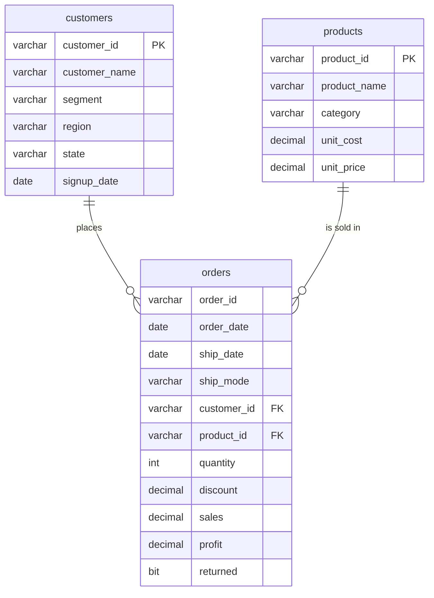

# Retail Sales Analysis with SQL Server

A beginner-to-intermediate SQL project that analyzes retail sales data and answers **8 business questions** using T-SQL.

---

## Project Overview

A retail company wants to understand how its business performs: how much it sells, which products and customers matter most, which regions perform best, and where it loses money through returns.

This project loads three related tables into **SQL Server**, joins them with a single view, and answers 8 business questions with simple, readable queries.

## Tools Used

| Tool | Purpose |
|------|---------|
| SQL Server (Express) | Database engine |
| SSMS | Writing and running queries |
| Power BI (optional) | Dashboard for the key results |
| GitHub | Sharing the project |

## Dataset

The data covers orders placed from **January 2022 to December 2023** (1,500 orders) and is split into three tables.

| Table | Description | Key columns |
|-------|-------------|-------------|
| `customers` | 220 customers | `customer_id`, `segment`, `region`, `state`, `signup_date` |
| `products` | 25 products in 5 categories | `product_id`, `product_name`, `category`, `unit_cost`, `unit_price` |
| `orders` | One row per product in an order | `order_id`, `order_date`, `ship_mode`, `customer_id`, `product_id`, `quantity`, `discount`, `sales`, `profit`, `returned` |

**Categories:** Electronics, Furniture, Office Supplies, Clothing, Home & Kitchen
**Customer segments:** Consumer, Corporate, Home Office
**Regions:** North, South, East, West, Central
**Ship modes:** Standard, Express, Same Day

### Table Relationships



---

## Repository Structure

```
.
├── README.md
├── queries.sql        # View + the 8 business queries
├── customers.csv
├── products.csv
├── orders.csv
└── images/            # Screenshots of the query results
```

## How to Run

1. Import the three CSV files into SQL Server as tables named `customers`, `products`, and `orders`
   (SSMS: right-click the database → Tasks → Import Flat File).
2. Check the column types: dates as `date`, `quantity` as `int`, money columns as `decimal`.
3. Open `queries.sql` and run the `CREATE OR ALTER VIEW v_sales` part once.
4. Run each question one at a time (select the query, then press Execute).

---

## The View Used in All Queries

To keep the queries short, one view joins the three tables:

```sql
CREATE OR ALTER VIEW v_sales AS
SELECT
    o.order_id, o.order_date, YEAR(o.order_date) AS order_year,
    o.ship_mode, o.quantity, o.discount, o.sales, o.profit, o.returned,
    c.customer_id, c.customer_name, c.segment, c.region,
    p.product_name, p.category
FROM orders AS o
JOIN customers AS c ON c.customer_id = o.customer_id
JOIN products  AS p ON p.product_id  = o.product_id;
```

---

## Business Questions

| # | Question | SQL Skills Used |
|---|----------|-----------------|
| 1 | What are the overall business numbers? | `COUNT DISTINCT`, `SUM`, `CAST` |
| 2 | How do sales and profit change from year to year? | `GROUP BY`, `ORDER BY` |
| 3 | Which product category brings the most sales and profit? | `GROUP BY`, `SUM` |
| 4 | What are the top 5 most profitable products? | `TOP`, `GROUP BY` |
| 5 | Who are the top 10 customers by sales? | `TOP`, `GROUP BY` |
| 6 | Which region sells the most, and which segment is strongest in each region? | `GROUP BY` on two columns |
| 7 | How many returned items are there in each category? | `WHERE`, `COUNT` |
| 8 | Which shipping mode is used the most? | `COUNT DISTINCT`, `ROUND` |

---

### Q1. What are the overall business numbers?

```sql
SELECT
    COUNT(DISTINCT order_id)    AS total_orders,
    COUNT(DISTINCT customer_id) AS total_customers,
    SUM(sales)                  AS total_sales,
    SUM(profit)                 AS total_profit,
    CAST(100.0 * SUM(profit) / SUM(sales) AS DECIMAL(5,2)) AS profit_margin_pct
FROM v_sales;
```


**Insight:** _Write one sentence here after running the query._

---

### Q2. How do sales and profit change from year to year?

```sql
SELECT
    order_year,
    COUNT(DISTINCT order_id) AS total_orders,
    SUM(sales)               AS total_sales,
    SUM(profit)              AS total_profit
FROM v_sales
GROUP BY order_year
ORDER BY order_year;
```


**Insight:** _Write one sentence here after running the query._

---

### Q3. Which product category brings the most sales and profit?

```sql
SELECT
    category,
    SUM(quantity) AS units_sold,
    SUM(sales)    AS total_sales,
    SUM(profit)   AS total_profit,
    CAST(100.0 * SUM(profit) / SUM(sales) AS DECIMAL(5,2)) AS profit_margin_pct
FROM v_sales
GROUP BY category
ORDER BY total_profit DESC;
```


**Insight:** _Write one sentence here after running the query._

---

### Q4. What are the top 5 most profitable products?

```sql
SELECT TOP 5
    product_name,
    category,
    SUM(quantity) AS units_sold,
    SUM(sales)    AS total_sales,
    SUM(profit)   AS total_profit
FROM v_sales
GROUP BY product_name, category
ORDER BY total_profit DESC;
```


**Insight:** _Write one sentence here after running the query._

---

### Q5. Who are the top 10 customers by sales?

```sql
SELECT TOP 10
    customer_id,
    customer_name,
    segment,
    COUNT(DISTINCT order_id) AS total_orders,
    SUM(sales)               AS total_sales
FROM v_sales
GROUP BY customer_id, customer_name, segment
ORDER BY total_sales DESC;
```


**Insight:** _Write one sentence here after running the query._

---

### Q6. Which region sells the most, and which segment is strongest in each region?

```sql
SELECT
    region,
    segment,
    SUM(sales)  AS total_sales,
    SUM(profit) AS total_profit
FROM v_sales
GROUP BY region, segment
ORDER BY region, total_sales DESC;
```


**Insight:** _Write one sentence here after running the query._

---

### Q7. How many returned items are there in each category?

```sql
SELECT
    category,
    COUNT(*) AS returned_items
FROM v_sales
WHERE returned = 1
GROUP BY category
ORDER BY returned_items DESC;
```


**Insight:** _Write one sentence here after running the query._

---

### Q8. Which shipping mode is used the most, and how much does it sell?

```sql
SELECT
    ship_mode,
    COUNT(DISTINCT order_id) AS total_orders,
    ROUND(SUM(sales), 0)     AS total_sales
FROM v_sales
GROUP BY ship_mode
ORDER BY total_orders DESC;
```


**Insight:** _Write one sentence here after running the query._

---

## Key Findings

Fill this table after running the queries.

| Area | Finding |
|------|---------|
| Overall performance | _..._ |
| Best category | _..._ |
| Best region | _..._ |
| Top customers | _..._ |
| Returns | _..._ |
| Shipping | _..._ |

## Dashboard (Optional)


## Skills Demonstrated

- Joining multiple tables (`JOIN`)
- Summarizing data (`GROUP BY`, `SUM`, `COUNT`)
- Filtering and sorting (`WHERE`, `ORDER BY`, `TOP`)
- Creating a reusable view (`CREATE VIEW`)
- Turning query results into business insights

## Author

_Your name_ · _LinkedIn link_
